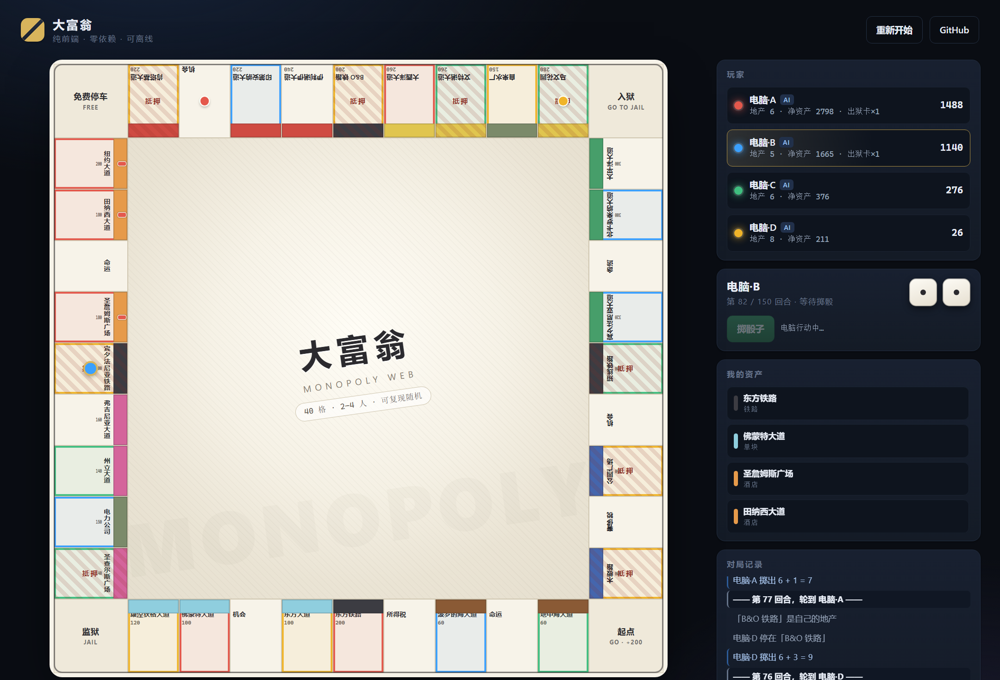

# 大富翁 · Monopoly Web

标准 40 格规则的浏览器大富翁。**零依赖、无构建、纯 ES Modules**，克隆下来就能跑。



## 特性

- **标准棋盘** —— 40 格、8 个地产街区、4 条铁路、2 家公用事业，租金表与官方规则一致
- **完整规则** —— 双数追加回合、三次双数入狱、均富建造、抵押与赎回、破产清算、经过起点领薪
- **机会与命运** —— 30 张卡牌，覆盖移动、收款、付款、维修、出狱卡、互相转账
- **AI 对手** —— 1–3 个电脑玩家，会补齐色组、把现金转成房屋、缺钱时抵押自救
- **可复现对局** —— 使用种子随机数，同一个种子必然产生同一局棋（便于复现 bug 与做基准测试）
- **存档续玩** —— 引擎状态完整可序列化（含 RNG 游标与牌序），存读档后对局逐字节一致
- **零依赖** —— 没有 React、没有打包器、没有 `node_modules`；源码就是运行产物
- **可离线** —— 全部静态文件，下载到本地双击 `index.html` 也能跑

## 快速开始

ES Modules 不能在 `file://` 下工作（浏览器 CORS 限制），所以需要一个静态服务器。任选其一：

```bash
# 项目自带的零依赖服务器
node scripts/serve.mjs        # → http://127.0.0.1:8123/

# 或者用 Python
python -m http.server 8123
```

然后打开 <http://127.0.0.1:8123/>，选人数，开始。

> 直接双击 `index.html` 会白屏——这是浏览器的模块加载安全策略，不是代码问题。

## 玩法

1. 掷骰子前进，落在无主地产时可以购买
2. 集齐同色街区后，基础租金**翻倍**，并获得建房资格
3. 同一街区内必须**均富建造**（不能一栋别墅配两块空地）
4. 现金不足时可以抵押地产（可收半价，赎回需付 110%）
5. 走到别人有房的地产按对应档位付租；付不出且无资产可变卖 → 破产出局
6. 最后只剩一名玩家，或到达回合上限时净资产最高者获胜

## 规则边界（重要）

这是一个**忠实但不完整**的官方规则实现。明确说明差异，避免误判：

| 规则 | 状态 | 说明 |
|---|---|---|
| 地产交易（买卖协议） | ❌ 未实现 | 因此纯 AI 对局可能长期无人破产 |
| 拍卖（放弃购买后拍卖） | ❌ 未实现 | 放弃即流拍 |
| 回合上限判胜 | ✅ 自定义 | 默认 150 回合，到顶按净资产判胜，避免无限拖长 |
| 收入税可选 10% 或固定 200 | ⚠️ 简化 | 固定 200 |
| 免费停车奖金 | ⚠️ 简化 | 无奖金池，纯休息 |
| 本地存档 / 续玩 | ✅ 已支持 | 引擎状态完整可序列化，含 RNG 游标与牌序 |

这些差异是**有意的范围选择**，不是遗漏——见下方 Roadmap。

> ⚠️ 关于「回合上限」：它保证了对局一定会结束，但**不代表对局质量好**。
> 用 `node scripts/simulate.mjs 40 4` 可以看到「撞上限判胜」占比——当前约 87.5%，
> 意味着绝大多数对局并不是自然收束，而是被上限截断的。这才是待解决的真正问题。

## 架构

引擎与界面完全分离：规则不依赖 DOM，界面不实现规则。

```
monopoly/
├── index.html                 # 唯一页面
├── styles/main.css            # 全套样式（深色外壳 + 纸感棋盘）
├── src/
│   ├── engine/
│   │   ├── data.js            # 40 格棋盘、街区索引、常量
│   │   ├── cards.js           # 机会/命运牌面数据
│   │   ├── game.js            # 规则引擎（纯逻辑，含状态机）
│   │   └── rng.js             # mulberry32 种子随机
│   ├── ai/bot.js              # AI 决策（纯函数：吃状态，吐动作）
│   └── ui/main.js             # 渲染、交互、机器人节奏调度
├── tests/game.test.js         # 规则单元测试（node:test）
└── scripts/
    ├── serve.mjs              # 零依赖静态服务器
    └── simulate.mjs           # 无头自对弈，验证收敛性与 AI 行为
```

三个设计约束：

1. **引擎零 DOM 依赖** —— 所以 `node --test` 能直接测规则，也能跑无头模拟
2. **AI 是纯函数** —— `decide(game)` 返回动作描述，不执行；UI 负责节奏，模拟器负责批量跑
3. **数据与规则分离** —— 加一张卡牌只改 `cards.js`，加一块地只改 `data.js`

关于存档：所有可变状态（含 RNG 游标 `state.rng`、洗好的牌堆 `state.decks`、
牌堆游标 `state.deckIndex`、回合上限 `state.maxTurns`）都集中在 `this.state` 内，
因此 `game.snapshot()` 一次 JSON 往返就是完整对局，`game.restore()` 能逐字节恢复
——后续骰子序列与抽牌序列都不会分叉（由 AC-S1 回归测试守着）。

## 测试

```bash
node --test tests/game.test.js     # 32 个用例：租金、建房、抵押、入狱、破产、存档、AI 决策
node scripts/simulate.mjs 40 4     # 40 局四人自对弈，检查收敛性与统计
```

模拟器输出示例：

```
局数 40 · 人数 4
已分出胜负: 40 / 40   未结束: 0
撞上限判胜: 35 / 40（87.5%）
平均回合: 149.0   最长: 151
平均建房数: 10.7   最多: 47
平均抵押数: 1.8
平均破产人数: 0.6
```

**怎么读这组数字**：`未结束: 0` 只说明回合上限在工作（不会死锁），
它**不是**对局质量的证据。真正反映自然收束程度的是 `撞上限判胜` ——
当前 87.5%，即绝大多数对局是被上限截断的，只有约 12.5% 靠破产自然结束。
关闭上限后约有一半对局永远打不完（可行性实验复现：40 局·4 人，关上限后仅 21/40 自然结束）。

模拟器对引擎异常**fail-fast**：任何相位错配或非法动作都会直接抛出并带上上下文，
不会再被静默吞掉——所以「异常次数」这个指标是可信的。

## 存档 / 续玩

对局进行中（轮到真人时）控制区会出现 **存档** / **读档** 按钮，存档写入 `localStorage`。
因为 RNG 游标与牌序都在可序列化状态内，读档后的骰子与抽牌序列和中断前完全一致。

## 调试参数

在 URL 上追加查询参数便于验证特定状态：

| 参数 | 作用 |
|---|---|
| `?demo=1` | 跳过开局弹窗直接开始 |
| `&bot=1` | 全部玩家交给 AI（用于观察对局） |
| `&seed=1263` | 固定随机种子（纯数字直接用作种子） |
| `&speed=30` | AI 行动间隔毫秒数，加速演示 |
| `&players=4` | 玩家人数 2–4 |

例：`?demo=1&bot=1&players=4&seed=1263&speed=30`

## Roadmap

- [ ] 地产交易（AI 估价报价 + 玩家协商界面）—— 这是让对局自然收束的关键，优先级最高
- [ ] 放弃购买后的拍卖流程
- [ ] 联机对战（WebRTC 或最小信令服务器）
- [ ] 音效与动画强化
- [x] 本地存档 / 断点续玩（引擎状态完整可序列化，含 RNG 与牌序）

## 许可

[MIT](LICENSE) © 2026 二维马
